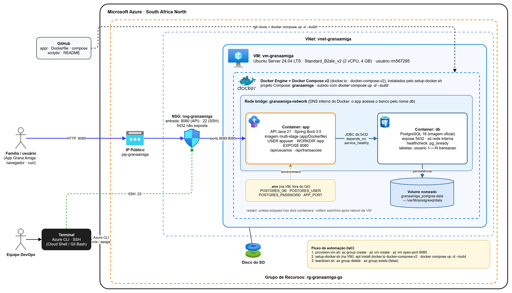

# Grana Amiga – DevOps Tools & Cloud Computing

**Global Solution 2026/2 · FIAP · CitizenTech – Serviços e direitos**

A **Grana Amiga** é uma CitizenTech de educação e organização financeira para famílias brasileiras de baixa renda. Em julho de 2026, 82% das famílias tinham dívidas (recorde da série Peic/CNC), chegando a 84,9% entre quem ganha até três salários mínimos. O app combina jogos educativos, um *Termômetro do Dinheiro* (Verde, Amarelo, Vermelho) e um medidor de energia IoT que mostra em reais o custo da conta de luz.

Nesta disciplina, a **API Java (Spring Boot)** da solução roda em **dois containers integrados** (API + PostgreSQL) com **Docker Compose**, dentro de uma **VM Linux na Microsoft Azure criada por Azure CLI**.

<!-- TODO: trocar pelo link do vídeo quando publicado -->
**Vídeo da demonstração:** _em breve_

## Integrantes

Turma: **2TDSPR**

| Nome | RM |
|------|----|
| Cassio Ribeiro | 567295 |
| Davi Isac Colin Pereira | 567265 |
| Hugo Souza de Jesus | 568542 |
| Matheus Peres Moraes de Jesus | 567300 |
| Pedro Gonçalves Rodrigues | 567651 |

---

## Arquitetura



> Fonte editável: [`docs/arquitetura.drawio`](docs/arquitetura.drawio) (abrir no [draw.io](https://app.diagrams.net/)).

**Fluxo:** o usuário (app, navegador ou cURL) acessa o **IP público da VM** na porta **8080**. O **NSG** da Azure libera só as portas 22 (SSH) e 8080 (API). O Docker encaminha a requisição para o container **`app`** (API Spring Boot), que grava e lê os dados no container **`db`** (PostgreSQL) pela rede interna **`granaamiga-network`**, usando o nome do serviço `db` como host. Os dados do banco ficam no volume nomeado **`granaamiga_postgres-data`**, então sobrevivem à recriação dos containers. A porta 5432 do banco **não** é exposta para a internet.

| Componente | Tecnologia |
|------------|------------|
| Nuvem | Microsoft Azure (Grupo de Recursos, VM, VNet, NSG, IP público) |
| Provisionamento | Azure CLI (`scripts/provision-vm.sh`) |
| Sistema da VM | Ubuntu Server 24.04 LTS · `Standard_B2als_v2` (2 vCPU, 4 GB) |
| Containers | Docker Engine + Docker Compose v2 |
| Aplicação (`app`) | Java 21 + Spring Boot 3.5 · imagem multi-stage, usuário não-root |
| Banco (`db`) | PostgreSQL 16 · volume nomeado |

---

## Estrutura do repositório

```
.
├── app/                        # Código-fonte da API Java
│   ├── Dockerfile              # Imagem da API (multi-stage, usuário não-root)
│   ├── .dockerignore
│   ├── pom.xml
│   └── src/main/...            # Entidades usuario e transacao, CRUD REST
├── scripts/
│   ├── provision-vm.sh         # Azure CLI: grupo de recursos, VM e porta 8080
│   ├── setup-docker.sh         # Na VM: instala Docker + Compose e sobe os containers
│   └── teardown.sh             # Azure CLI: apaga o grupo de recursos
├── docs/
│   ├── arquitetura.png         # Arquitetura macro da solução
│   ├── arquitetura.drawio      # Fonte editável do diagrama
│   └── evidencias/             # Prints da execução na VM
├── docker-compose.yml          # Serviços app + db, rede e volume
├── .env.example                # Modelo das variáveis (o .env real não vai para o Git)
├── .gitattributes              # Força quebra de linha LF nos scripts .sh
└── .gitignore
```

---

## Como executar (How To)

> Todos os comandos `bash` abaixo rodam no **Azure Cloud Shell (Bash)**, no **Git Bash** ou no **WSL**.
> No **PowerShell** do Windows, use `curl.exe` em vez de `curl` (no PowerShell 5.1, `curl` é outro comando).

### Pré-requisitos

- Conta na Microsoft Azure com créditos (ex.: Azure for Students).
- [Azure CLI](https://learn.microsoft.com/cli/azure/install-azure-cli) instalado **ou** o Azure Cloud Shell (já vem com Azure CLI e Git).
- Git e cliente SSH (já vêm no Git Bash, no WSL e no Cloud Shell).

### 1. Clonar o repositório e entrar na Azure

```bash
git clone https://github.com/grana-amiga/DevOps-Tools_Cloud-Computing.git
cd DevOps-Tools_Cloud-Computing
az login
```

> No Cloud Shell o `az login` não é necessário.

### 2. Criar a infraestrutura na Azure (Azure CLI)

```bash
chmod +x scripts/*.sh
./scripts/provision-vm.sh
```

O script pede a senha do usuário da VM (12 a 72 caracteres, com maiúscula, minúscula, número e símbolo; a digitação não aparece na tela) e, no fim, mostra o **IP público** e o comando `ssh` pronto.

Comandos executados pelo script, na ordem:

```bash
az account show --query "{Sub:id, Nome:name}" -o jsonc
az group create --name rg-granaamiga-gs --location southafricanorth
az vm create --resource-group rg-granaamiga-gs --name vm-granaamiga --location southafricanorth \
  --image Ubuntu2404 --size Standard_B2als_v2 --authentication-type password \
  --admin-username rm567295 --admin-password <SENHA> \
  --vnet-name vnet-granaamiga --nsg nsg-granaamiga --public-ip-address pip-granaamiga \
  --public-ip-sku Standard --tags "owner=GranaAmiga" "purpose=GlobalSolution"
az vm open-port --resource-group rg-granaamiga-gs --name vm-granaamiga --port 8080 --priority 1010
```

> Para usar outro usuário, região ou tamanho de VM, edite as variáveis no topo de `scripts/provision-vm.sh` e de `scripts/teardown.sh`.

### 3. Conectar na VM

```bash
ssh rm567295@<IP_PUBLICO_DA_VM>
```

### 4. Clonar o repositório na VM e configurar o `.env`

```bash
git clone https://github.com/grana-amiga/DevOps-Tools_Cloud-Computing.git
cd DevOps-Tools_Cloud-Computing
cp .env.example .env
nano .env
```

No `nano`, troque **pelo menos** o valor de `POSTGRES_PASSWORD` (salvar: `Ctrl+O`, Enter; sair: `Ctrl+X`). O script do próximo passo não continua se a senha de exemplo não for trocada.

| Variável | Uso | Exemplo |
|----------|-----|---------|
| `POSTGRES_DB` | Nome do banco criado no container `db` | `granaamiga` |
| `POSTGRES_USER` | Usuário do banco (também usado pela API) | `granaamiga_user` |
| `POSTGRES_PASSWORD` | Senha do banco (também usada pela API) | _defina uma senha forte_ |
| `APP_PORT` | Porta publicada da API na VM | `8080` |

### 5. Instalar Docker + Compose e subir os containers

```bash
chmod +x scripts/*.sh
./scripts/setup-docker.sh
```

O script instala `docker.io`, `docker-compose-v2` e `docker-buildx`, habilita o Docker no boot, confere o `.env` e executa:

```bash
sudo docker compose up -d --build
sudo docker compose ps
```

Ao final, ele espera a API responder na porta 8080.

### 6. Testar o CRUD (pela sua máquina, usando o IP público)

Defina o IP uma vez para copiar os comandos sem editar:

```bash
IP=<IP_PUBLICO_DA_VM>
```

**Usuário (`/api/usuarios`)**

```bash
# CREATE
curl -X POST http://$IP:8080/api/usuarios \
  -H "Content-Type: application/json" \
  -d '{"nome":"Maria Silva","telefone":"11999990001","rendaMensal":2800.00}'

# READ (lista e por id)
curl http://$IP:8080/api/usuarios
curl http://$IP:8080/api/usuarios/1

# UPDATE
curl -X PUT http://$IP:8080/api/usuarios/1 \
  -H "Content-Type: application/json" \
  -d '{"nome":"Maria Silva Santos","telefone":"11999990001","rendaMensal":3100.00}'
```

**Transação (`/api/transacoes`, ligada a um usuário)**

```bash
# CREATE
curl -X POST http://$IP:8080/api/transacoes \
  -H "Content-Type: application/json" \
  -d '{"usuarioId":1,"valor":150.75,"tipo":"SAIDA","descricao":"Supermercado"}'

curl -X POST http://$IP:8080/api/transacoes \
  -H "Content-Type: application/json" \
  -d '{"usuarioId":1,"valor":89.90,"tipo":"SAIDA","descricao":"Conta de luz"}'

# READ (todas, por id e por usuário)
curl http://$IP:8080/api/transacoes
curl http://$IP:8080/api/transacoes/1
curl "http://$IP:8080/api/transacoes?usuarioId=1"

# UPDATE
curl -X PUT http://$IP:8080/api/transacoes/1 \
  -H "Content-Type: application/json" \
  -d '{"usuarioId":1,"valor":160.00,"tipo":"SAIDA","descricao":"Supermercado - ALTERADO"}'

# DELETE
curl -X DELETE http://$IP:8080/api/transacoes/2
```

| Método | Caminho | Função | Status |
|--------|---------|--------|--------|
| POST | `/api/usuarios` | Cadastrar usuário | 201 |
| GET | `/api/usuarios` · `/api/usuarios/{id}` | Listar · consultar | 200 / 404 |
| PUT | `/api/usuarios/{id}` | Atualizar | 200 / 404 |
| DELETE | `/api/usuarios/{id}` | Excluir (apaga as transações dele em cascata) | 204 / 404 |
| POST | `/api/transacoes` | Cadastrar transação | 201 / 400 |
| GET | `/api/transacoes` · `/api/transacoes/{id}` · `?usuarioId=` | Listar · consultar · filtrar por usuário | 200 / 404 |
| PUT | `/api/transacoes/{id}` | Atualizar | 200 / 404 |
| DELETE | `/api/transacoes/{id}` | Excluir | 204 / 404 |

Campos de `tipo`: `ENTRADA` ou `SAIDA`.

### 7. Verificar containers, logs, usuário e banco (dentro da VM)

```bash
# Containers em execução
sudo docker ps
sudo docker compose ps

# Logs
sudo docker compose logs app
sudo docker compose logs db

# Acesso a cada container e usuário utilizado
sudo docker exec app whoami          # appuser (não-root)
sudo docker exec -it app bash        # dentro: pwd -> /app (WORKDIR) ; exit
sudo docker exec -it db bash         # dentro: ls /var/lib/postgresql/data ; exit
sudo docker top db                   # o processo postgres roda com UID 999 (usuário postgres), não root

# Rede e volume
sudo docker network ls
sudo docker volume ls
sudo docker volume inspect granaamiga_postgres-data
```

**SELECT direto no banco** (usa o usuário e o banco definidos no `.env`):

```bash
sudo docker exec db sh -c 'psql -U "$POSTGRES_USER" -d "$POSTGRES_DB" -c "\dt"'
sudo docker exec db sh -c 'psql -U "$POSTGRES_USER" -d "$POSTGRES_DB" -c "SELECT * FROM usuario;"'
sudo docker exec db sh -c 'psql -U "$POSTGRES_USER" -d "$POSTGRES_DB" -c "SELECT u.nome, t.id, t.valor, t.tipo, t.descricao FROM transacao t JOIN usuario u ON u.id = t.usuario_id;"'
```

### 8. Comprovar a persistência

```bash
sudo docker compose down             # remove os containers e a rede (o volume continua)
sudo docker compose up -d
sudo docker compose ps               # aguarde o app ficar "Up"
sudo docker exec db sh -c 'psql -U "$POSTGRES_USER" -d "$POSTGRES_DB" -c "SELECT * FROM usuario;"'
```

Os dados cadastrados no passo 6 continuam no banco. Também é possível reiniciar a VM (`sudo reboot`): por causa do `restart: unless-stopped` e do Docker habilitado no boot, os containers voltam sozinhos.

> `sudo docker compose down -v` apagaria também o volume e, com ele, os dados.

### 9. Apagar os recursos da Azure (evita gastar créditos)

Na sua máquina ou no Cloud Shell (fora da VM):

```bash
./scripts/teardown.sh
```

O script apaga o grupo de recursos `rg-granaamiga-gs` (VM, IP, VNet, NSG e discos) e confirma com `az group exists`, que deve responder `false`.

---

## Decisões técnicas

- **Dockerfile multi-stage:** o Maven e o JDK ficam só no estágio de build; a imagem final tem apenas o JRE e o `.jar`, ficando menor e com menos superfície de ataque.
- **Usuário não-root (`appuser`):** se a API for comprometida, o invasor não tem privilégios de root dentro do container.
- **Segredos fora da imagem e do Git:** usuário e senha do banco ficam no `.env` (no `.gitignore`) e entram nos containers pelo `environment` do Compose. O Dockerfile só tem valores não sensíveis.
- **`healthcheck` + `depends_on: service_healthy`:** a API só sobe depois que o PostgreSQL aceita conexões (`pg_isready`), e não apenas quando o container do banco inicia.
- **Banco sem porta publicada (`expose`):** a API acessa o banco pela rede interna do Docker; a porta 5432 não fica aberta para a internet.
- **Volume nomeado:** os dados ficam fora do ciclo de vida do container e sobrevivem a `docker compose down` + `up`.
- **Infraestrutura como código:** VM, rede e firewall criados por script com Azure CLI; o ambiente pode ser recriado ou apagado a qualquer momento.

---

## Evidências

<!-- TODO: adicionar os prints em docs/evidencias/ após a execução na VM -->

| Evidência | Arquivo |
|-----------|---------|
| VM criada pela Azure CLI | `docs/evidencias/01-provision-vm.png` |
| `docker ps` / `docker compose ps` na VM | `docs/evidencias/02-docker-ps.png` |
| `docker compose logs` | `docs/evidencias/03-logs.png` |
| `docker exec` + `whoami` (usuário não-root) | `docs/evidencias/04-exec-whoami.png` |
| Estrutura de diretórios | `docs/evidencias/05-estrutura.png` |
| CRUD (POST, GET, PUT, DELETE) pelo IP público | `docs/evidencias/06-crud.png` |
| `SELECT` direto no banco | `docs/evidencias/07-select.png` |
| Persistência após `down` + `up` | `docs/evidencias/08-persistencia.png` |
| Remoção dos recursos (`az group exists` = false) | `docs/evidencias/09-teardown.png` |

---

## Uso de IA generativa

Este repositório foi desenvolvido com apoio do **Claude Code (Anthropic)**, usado para: revisar o Dockerfile e o `docker-compose.yml` contra os requisitos da disciplina, adaptar os scripts de Azure CLI, gerar a API Spring Boot mínima de validação e redigir este README. Todo o conteúdo foi revisado, executado e validado pelo grupo.
